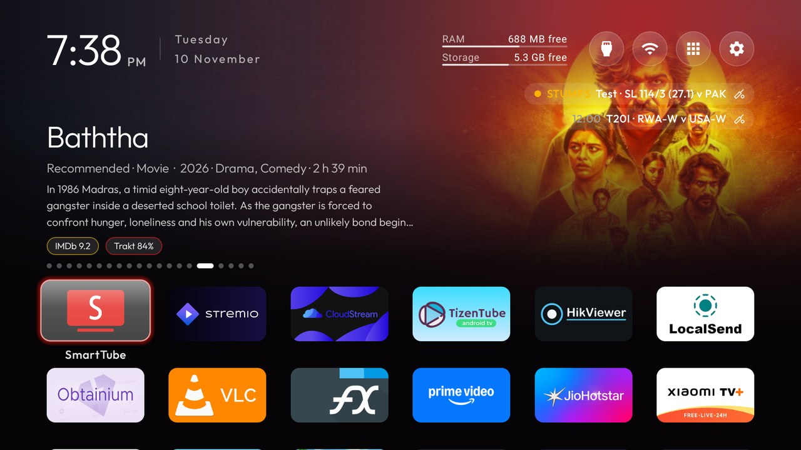
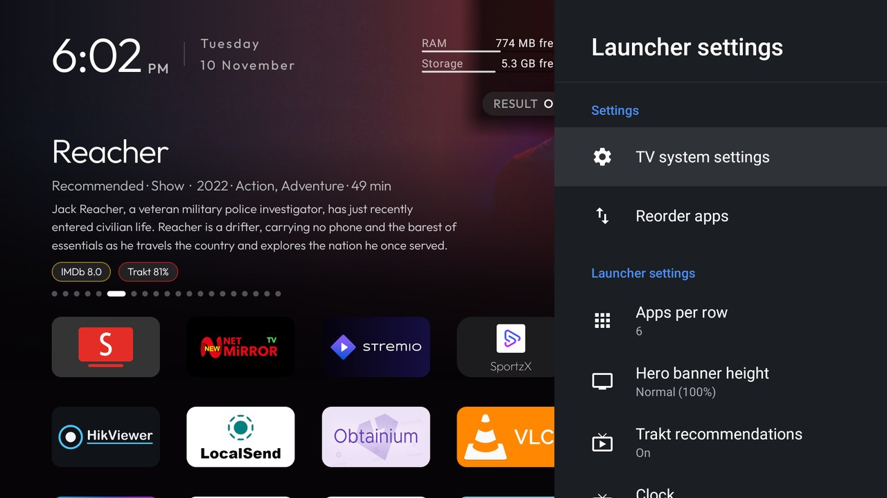
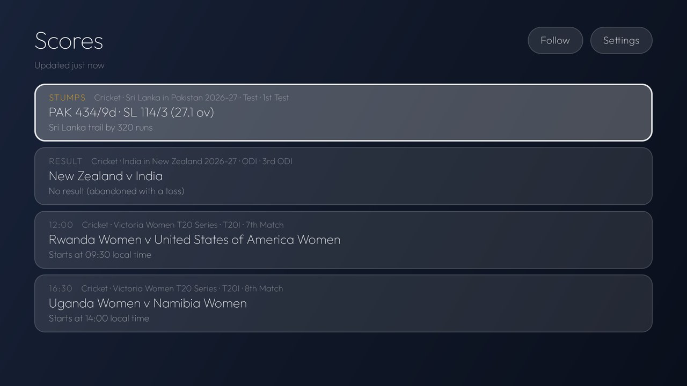

# VerySmartTV

[](https://github.com/itsluminous/verysmarttv/actions/workflows/ci.yml) [](https://github.com/itsluminous/verysmarttv/releases) [](LICENSE)  

**VerySmartTV** is a lean, ad-free home screen for Android TV in a frosted-glass look, built for sets with 1 GB of RAM: a dock and a grid of your apps, a clock, and three round buttons for Inputs, the network and Settings. The launcher itself has no network access. Two companion apps feed it through content providers: **Trakt** turns the top shelf into a carousel of what to watch next from your Trakt account, and **Live scores** puts your teams' live matches under the clock, with a sport icon on each line. A one-command setup tool installs the three apps over Wi-Fi, makes the launcher Home behind a guard that never leaves the TV without one, and, if you ask, switches off the TV maker's preloaded apps from the community lists of 434 TV models. Nothing is uninstalled, and one command puts it all back.

<a href="https://github.com/itsluminous/verysmarttv/releases/latest">
  
</a>
<a href="https://apps.obtainium.imranr.dev/redirect?r=obtainium://app/%7B%22id%22%3A%22com.itsluminous.verysmarttv%22%2C%22url%22%3A%22https%3A%2F%2Fgithub.com%2Fitsluminous%2Fverysmarttv%22%2C%22author%22%3A%22itsluminous%22%2C%22name%22%3A%22VerySmartTV%22%2C%22additionalSettings%22%3A%22%7B%5C%22includePrereleases%5C%22%3Afalse%2C%5C%22apkFilterRegEx%5C%22%3A%5C%22launcher%5C%22%7D%22%7D">
  
</a>

The Obtainium link tracks the launcher APK of each release; the two companions come from the same release page, by the setup tool or by hand ([Install](#install)).

## Screenshots

Taken on a Xiaomi Mi TV 4A (Android TV 10) running 0.1.0 with the `frosted` theme.

| Home | Launcher settings |
| :---: | :---: |
|  |  |

| Live scores | Trakt |
| :---: | :---: |
|  |  |

## Features

- **Launcher** (`com.itsluminous.verysmarttv`): a dock row and a grid of your apps with one floating glass highlight that springs from tile to tile; a top shelf that names the focused app in large type over an ambient glow in its colour, or shows the Trakt carousel; a greeting, a thin clock and the date; three frosted buttons for Inputs (HDMI ports under the names you gave them, AV, Live TV), the network and Settings; an **All apps** grid; a tile menu (hold OK: Move, Remove from Home, App info); **Reorder apps**; a Clock screensaver that drifts so nothing burns in; 31 languages, following the TV's. No `INTERNET` permission, no background services, no blur, no video: a 550 KB APK, built for 1 GB TVs.
- **Launcher settings** as a side panel over Home in the style of the TV's own Settings (`settings_panel`), or as a full-screen page: TV system settings first, then the launcher's rows with the value in force (Apps per row, Rows below dock, Dock band opacity, Hero banner height, Animations, the clock's hour format, Trakt recommendations, System bars, Live scores, Live score rows, Backup & restore, Reorder apps, Choose default home).
- **System bars**: a RAM and a Storage bar right of the date, each with its free amount (`22 GB free`), read every 5 seconds only while Home is on screen.
- **Trakt companion** (`com.itsluminous.traktshelf`): sign in with a code at `trakt.tv/activate`, no password on the TV. Rows of posters: Up next, Recommended shows, Recommended movies, Watchlist · Shows, Watchlist · Movies, Trending, Recently watched; titles you have already watched are left out of Trending and the recommendations. Details with synopsis, cast, IMDb, Rotten Tomatoes and Trakt ratings; **Play** through Stremio, CloudStream or NetMirror (a chooser, or a default player in its Settings), **Trailer** through TizenTube or SmartTube; add to or remove from the watchlist, mark watched. Syncs every 6 hours while online. Its provider feeds the launcher's **carousel**: backdrop faded under the top bar, title, synopsis, rating chips, one dot per item, one title every 8 seconds, OK opens it in Trakt.
- **Live scores companion** (`com.itsluminous.livescore`; its card on Home reads **Scores**): cricket, football, F1 and tennis from ESPN's public site feeds, with no account and no key; badminton from SportMicro's Badminton Micro API on RapidAPI with **your own key**, asked for the moment you first follow anything badminton (the free plan is 100 requests a day, so badminton is fetched at most every 5 minutes; **beyond the free tier the key may cost you money**, which is between you and RapidAPI). Or, as an experimental option in the Scores app's Settings (**Badminton source → BWF website**), badminton from BWF's own Match Centre read through a hidden browser view in a separate process that exits after each refresh: no key, live matches only, more memory for a few seconds per refresh and none kept, and it may stop working when the site changes. Follow sports, competitions, teams, players or a single match with three-state boxes in the picker; a scoreboard for the open match (the active batters and bowlers for cricket). On first run it follows India internationals and the IPL, the ISL, the Premier League, the Champions League and F1. Nothing is fetched while no screen shows a score.
- **The score stack** in the launcher: up to N lines (**Live score rows**, 1 to 5, two by default) stacked under the top-right buttons, each on its own rounded shade with a state dot, a kicker (`LIVE`, `STUMPS`, `HT`, a start time, `FT`), the line (`T20I · AFG 19/4 (6) v ZIM`, `Premier League · ARS 2–1 CHE 67'`, `F1 · São Paulo GP · Lap 32 · VER leads`) and the sport's icon. Live first, then a break, then upcoming within 12 hours, then finals within 6 hours; a line dims when its data is stale. Up from the grid lands on it, Up again goes to Inputs; OK opens the match in Live scores. Hidden, with nothing moving, while there is nothing to show or the companion is not installed.
- **Setup tool** (`setup/`): `setup.sh` for macOS and Linux, `setup.ps1` for Windows, Python 3.9 or newer, with its own ADB client (no `adb` binary). Finds the TV, installs the three APKs from the latest release with checksums verified, makes the launcher Home behind the Home guard, pushes a theme, offers the community clean-up list that matches your TV, and undoes it all with `setup restore`.
- **Themes**: a `config.json` (and an optional `wallpaper.jpg`) pushed over Wi-Fi changes the dock, the layout, the colours and every switch without a rebuild. Two ship: `default` (the built-in values) and `frosted` (six uniform rows over a slate wallpaper, the settings panel, the carousel, the All apps grid, the two-line date, the bars and the score stack on). Every key: [docs/themes.md](docs/themes.md).
- **Backup & restore**: one JSON file with the launcher's preferences, app order, hidden apps, dock, module-card approvals, theme and the Live scores follows; restore from the TV, or from a file pushed over ADB. A backup made by the CleanYourTV launcher restores too.

## How it works

1. **Three apps, one key.** The launcher, Trakt and Live scores are built from one Gradle project and signed with one release key. Each companion exposes a read-only content provider behind a permission with `protectionLevel="signature"`, so only an app signed with the same key can read your Trakt rows or your followed teams; `adb shell content query` is refused like any other app. The contracts are Java constants in `:core` that both sides compile against ([docs/providers.md](docs/providers.md)).
2. **The launcher only reads.** It observes the providers and re-queries when a companion notifies it. Backdrops for the carousel are decoded on demand into a cache of three; score lines arrive formatted by the companion and are drawn as they come, the launcher adding only the dot, the colours and the icon.
3. **Nothing runs while nothing is shown.** Trakt syncs every 6 hours while online. Live scores answers every query from its cache at once and fetches only when a followed match is live or about to start and the launcher or its own screen is reading: ESPN's feeds every 60 seconds, badminton every 5 minutes, one request per competition, with backoff (1, 2, 4, 8 minutes) when a feed fails and the last scores kept and marked stale. With no screen reading, a scheduled job wakes 2 minutes before the next followed start and a periodic one refreshes the fixture list every 6 hours.
4. **The setup tool and the Home guard.** The launcher is pushed, installed and started before Home is handed over, and the handover is checked; if Home does not resolve to VerySmartTV the stock launcher is put back. The stock launcher stays enabled unless you say so, and only the four known stock launchers (or one you name) are ever disabled. A clean-up list is applied in batches with a Home check and a screenshot between them, core Android packages are refused outright, and a record of the TV is written before the first change so `setup restore` replays it ([docs/SETUP.md](docs/SETUP.md)).

## Install

The guided flow on a computer on the same Wi-Fi as the TV. First switch on debugging on the TV: Settings → Device Preferences (or System) → About → press OK on **Build** seven times → back → Developer options → **USB debugging** on (and **Network debugging** or **ADB debugging**, if there is such a switch). Then:

```bash
git clone https://github.com/itsluminous/verysmarttv && cd verysmarttv
setup/setup.sh                       # macOS, Linux
```

```powershell
git clone https://github.com/itsluminous/verysmarttv; cd verysmarttv
powershell -ExecutionPolicy Bypass -File setup\setup.ps1     # Windows
```

The bootstrap finds a Python 3.9 or newer, makes a venv under `~/.verysmarttv/venv` with the one package it needs, and asks, step by step: which TV (mDNS, then a scan of port 5555, or an IP you type); to accept "Allow USB debugging?" on the TV; it downloads the latest release's three APKs and `SHA256SUMS` and verifies them; installs the companions and then the launcher and makes it Home (the stock launcher stays enabled unless you say yes; a stock that keeps Home by priority, such as the Mi TV 4A's PatchWall, is disabled first when you do); a theme (`frosted`, `default` or skip); the clean-up (the community list that matches your TV exactly, shown in full before the one question: disable these N packages? `e` keeps some); a reminder to sign in to Trakt and follow something in Live scores; and what to switch off to close ADB. Every step is re-runnable; `--yes` takes every default, `--dry-run` prints what the clean-up would send. The options and each subcommand on its own: [docs/SETUP.md](docs/SETUP.md).

**A warning in one sentence:** some community lists disable a package whose name holds `factory` or `hkcfac`, the maker's factory-test or service-menu app, and with it off the TV's service menu and some board self-tests stop working until `setup restore` enables it again, so the tool names each one and needs a typed yes before applying such a list.

**By hand.** Download `verysmarttv-launcher-<version>.apk`, `verysmarttv-traktshelf-<version>.apk` and `verysmarttv-livescore-<version>.apk` from the [Releases](https://github.com/itsluminous/verysmarttv/releases) page, then with the stock `adb`:

```bash
adb connect <tv ip>
adb install -r verysmarttv-traktshelf-<version>.apk
adb install -r verysmarttv-livescore-<version>.apk
adb install -r verysmarttv-launcher-<version>.apk
adb shell cmd package set-home-activity --user 0 com.itsluminous.verysmarttv/.home.HomeActivity
```

Android 8.0 (API 26) or newer. The companions are optional: without them the top shelf names the focused app and the score stack stays hidden. On a stock launcher that keeps Home by an intent-filter priority (Google's TV launcher, the Mi TV 4A's PatchWall) that last line says Success and Home stays where it was; the setup tool's `install --disable-stock` handles that case with a rollback if the handover fails.

**Verify a download.** `sha256sum -c SHA256SUMS` (or `shasum -a 256 -c`) against the file attached to the release, and the signer: `apksigner verify --print-certs verysmarttv-launcher-<version>.apk` (from the Android SDK build-tools) must print the certificate SHA-256 digest

```
15d5085a0400d720d4aea65edab4df72c6e5a5313844715c3e56859cec99c21d
```

on every APK of every release, 0.1.0 onwards. A different digest is not a build of this repository's release key, and its companions will not talk to this launcher.

**Tested on:** a Xiaomi Mi TV 4A (MiTV-MOOQ1, Android TV 10, 1 GB of RAM) and the Android TV emulator (API 34, `tv_1080p`), where CI also runs the Espresso suites. Debloat lists for 434 other models are carried as the community wrote them; the setup tool shows each list's header and applies it only on your yes.

## Usage tips

- **D-pad on Home**: Left/Right and Up/Down move between tiles; OK opens the app; hold OK on a tile for Move, Remove from Home and App info; Back on Home does nothing (or opens the clock screensaver with `back_opens_clock`). Up from the first row goes to the Trakt carousel while it shows, then to the score stack's **bottom** line (the one nearest the grid); inside the stack Up and Down move one line at a time; Up from its top line goes to **Inputs**; Down from its bottom line returns to the carousel or the tile. Left/Right along the round buttons; Back anywhere in the top bar returns to the grid. On the carousel Left/Right change the title and OK opens it in Trakt. Hold OK on **Settings** for Launcher settings (or press it, with `launcher_settings_button`).
- **Trakt sign-in**: open **Trakt** on Home, press **Sign in**, and enter the code at `trakt.tv/activate` on your phone. The first sync follows; the carousel appears once it has items. Settings → **Carousel rows** and **Carousel items** (6 to 20) choose what the launcher's shelf shows; **Watchlist order** sorts by date added or release date.
- **Following in Live scores**: open **Scores** (the card on Home) → **Follow**. The picker has three columns, sports, competitions, teams and matches; OK on a section follows everything under it (a bar in the box means some of it is followed, a tick all of it), OK on a ticked section clears it. Hold OK on a score line in the launcher to open the picker straight away.
- **The badminton key**: the first badminton follow asks for your RapidAPI key for SportMicro's Badminton Micro API (sign in at RapidAPI, subscribe to the API's free plan, copy the `x-rapidapi-key` the playground shows). Scores → Settings → **Badminton data key** shows its last four characters, changes or removes it. It stays on the TV; it is never in a backup, the APK or this repository. The free plan is 100 requests a day; beyond it the key may cost you money.
- **Badminton without a key (experimental)**: Scores → Settings → **Badminton source** → *BWF website (experimental)* reads BWF's own live page in a hidden browser instead of SportMicro (in a process of its own, gone after each refresh); *Off* leaves badminton out. When the site changes or refuses, the Scores app shows "BWF site unavailable" and the launcher's lines just have no badminton; switch back to SportMicro or wait for an update.
- **Live score rows**: Launcher settings → **Live score rows** picks 1 to 5 lines (two by default); **Live scores** Off hides the stack and stops the launcher reading the provider. With two live matches of one follow reason the companion turns its first line every 20 seconds, so a one-line stack shows both in turn.
- **Themes**: `setup/setup.sh theme --host <tv ip> frosted` pushes the frosted look; `default` is a reset in all but name, `--reset` removes the theme. A push clears the choices saved in Launcher settings. Your own theme is a folder with a `config.json`: [docs/themes.md](docs/themes.md) has every key.
- **Backup and restore**: Launcher settings → **Backup & restore** → **Back up settings** writes `verysmarttv-<date>.json` under `/sdcard/Android/data/com.itsluminous.verysmarttv/files/backup/`; **Restore from file** lists that folder, newest first, and replaces everything after a confirmation. Over ADB: `adb shell content read --uri content://com.itsluminous.verysmarttv.backup/settings > backup.json` reads it, and a file pushed into that folder is listed too. The provider is read-only; the file holds no tokens or keys. Moving from the CleanYourTV launcher: back it up the same way (its authority ends in `.backup` too) and restore the file here.
- **After a firmware update**: an update re-enables packages, hands Home back to the stock launcher and adds preloads. `setup/setup.sh check --host <tv ip> --preset <slug>` reports the drift (exit 1); `--fix` puts the list back and Home on VerySmartTV with the same checks as the first run.
- **Closing ADB**: port 5555 is plaintext, and on some firmware any device on the LAN gets a shell through it. When you are done: on the TV turn **USB debugging**, **Network/ADB debugging** and **Wireless debugging** off (whichever it has) and revoke the authorisations; reboot; then `setup/setup.sh adb-closed --host <tv ip>` must say the port is closed. The launcher keeps working without debugging.
- **Memory**: on the Mi TV 4A the Trakt companion sits at 55 to 60 MB PSS with its rows on screen and drops to a cached process after Back; on the 1 GB emulator Live scores holds about 15 MB of its own data idle and 24 MB with the scoreboard open, none of it bitmaps; the launcher reads the bars and the scores only while Home is on screen.

## Building

See [docs/BUILDING.md](docs/BUILDING.md) for the toolchain, the emulators, the identifier gate and release signing. In short: JDK 17 and Android SDK platform 36 with build-tools 36.0.0 (`local.properties` with `sdk.dir`); `./gradlew ci` runs what CI runs (unit tests, lint with warnings as errors, the 1,200-line file-length gate) and `./gradlew assembleDebug` builds the three APKs; `./gradlew connectedDebugAndroidTest` runs the Espresso suites on an Android TV emulator. The Trakt companion reads `TRAKT_CLIENT_ID`, `TMDB_API_KEY` and `OMDB_API_KEY` from the environment or a git-ignored `secrets.env` ([traktshelf/README.md](traktshelf/README.md)). Build all three yourself if you build one: a launcher and a companion from different signing keys do not talk to each other.

## Contributing

Issues and pull requests are welcome; [CONTRIBUTING.md](CONTRIBUTING.md) has the rules and [AGENTS.md](AGENTS.md) the same rules for a coding agent. Tests come with every change, `./gradlew ci` stays green, commit messages follow Conventional Commits, and no keystore, API key, IP address, Wi-Fi name or serial number ever lands in the tree. The debloat presets under `presets/lists/` are community lists from [CleanYourTV](https://github.com/Gathin23/cleanyourtv), carried verbatim with their testers' notes: a fix that makes a list better for every TV belongs upstream too, so send it there as well ([presets/README.md](presets/README.md)).

## References

VerySmartTV is a derived work of [CleanYourTV](https://github.com/Gathin23/cleanyourtv) by Gathin and its community (the launcher, the Trakt companion, the setup tooling and the 434 TV lists started there, MIT). [tv-town-launcher](https://github.com/NareshJagriya/tv-town-launcher) showed which ESPN site feeds carry live scores and how to poll them only while on screen (no code copied; GPL-3.0). [talkies](https://github.com/rajupp/talkies) shaped the notices file and this page's disclaimer. [HikViewer](https://github.com/itsluminous/HikViewer) gave the CI and release workflow, this README's shape and the vendored badges. The data comes from [Trakt](https://trakt.tv), [TMDB](https://www.themoviedb.org) (this product uses the TMDB API but is not endorsed or certified by TMDB), [OMDb](https://www.omdbapi.com), ESPN's public site feeds and [SportMicro's Badminton Micro API on RapidAPI](https://rapidapi.com/sportmicro-sportmicro-default/api/badminton-micro). Each is credited with its licence in [THIRD_PARTY_NOTICES.md](THIRD_PARTY_NOTICES.md). Release notes are in [CHANGELOG.md](CHANGELOG.md) and on each release; the design and every decision behind it are in [docs/design/](docs/design/DESIGN.md).

## Disclaimer

VerySmartTV is an unofficial, independent project. It is not affiliated with, endorsed by or supported by Xiaomi, Google, Trakt, TMDB, OMDb, ESPN, SportMicro, RapidAPI or the Badminton World Federation. The ESPN feeds the Live scores companion reads are undocumented and may change or stop at any time; the Badminton Micro API is used under the plan you subscribe to with your own key, and what it costs past the free tier is between you and RapidAPI; the optional BWF website source reads a public page through the TV's own browser engine and may stop working at any time. The clean-up works only through settings the TV offers its owner (Developer options, ADB, Android's own `pm disable-user`, the same switch as Settings → Apps → Disable): nothing is rooted, flashed or uninstalled, and `setup restore` puts everything back, but you run it on a TV you own, at your own risk, and changing a TV's software may affect its warranty.

## License

[MIT](LICENSE) © 2026 itsluminous. Derived from [CleanYourTV](https://github.com/Gathin23/cleanyourtv), MIT © 2026 Gathin, whose notice is reproduced in [LICENSE](LICENSE); everything else the project drew on is in [THIRD_PARTY_NOTICES.md](THIRD_PARTY_NOTICES.md).
